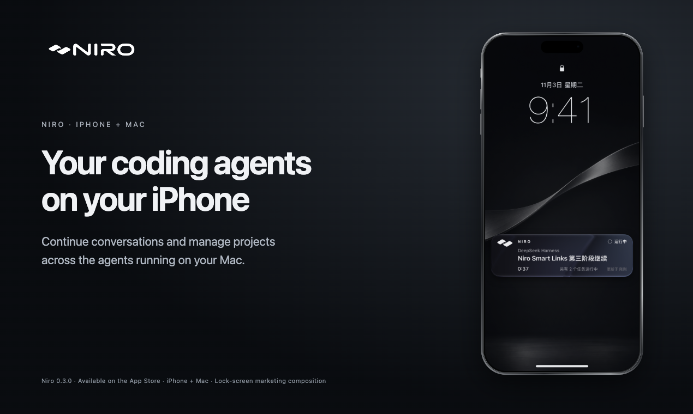
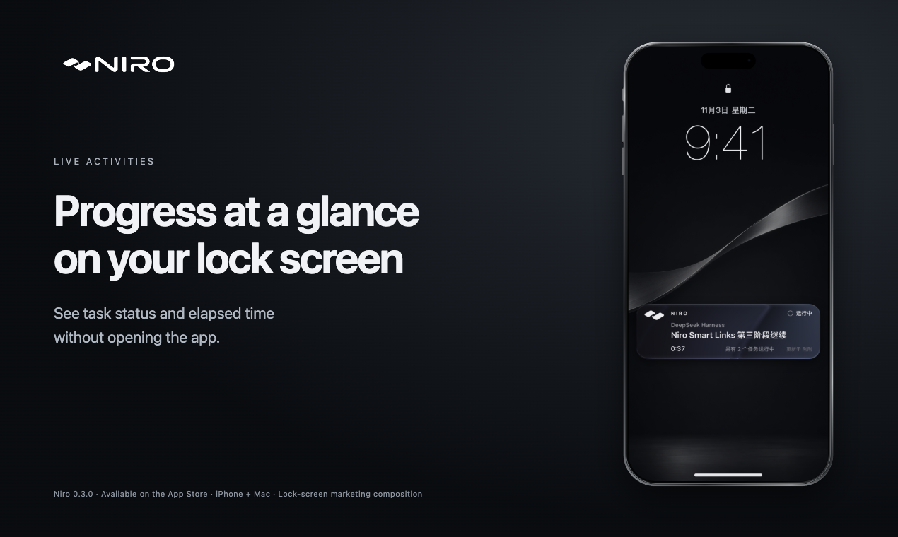
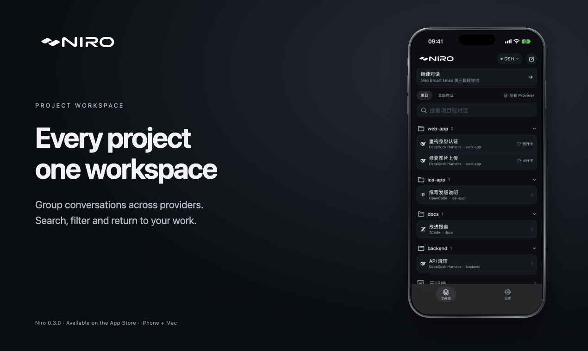

# Niro

**Your Coding Agents, on Your Phone.**

Niro is a free iPhone companion for the coding agents running on your Mac. Pick up a session, send the next instruction, check progress, and switch between supported providers without staying at your desk.

[**App Store**](https://apps.apple.com/app/niro/id6815434350) · [**Website**](https://niro.efremlee.com/?utm_source=github&utm_medium=referral&utm_campaign=niro_04_live) · [**Download Niro Bridge**](https://github.com/efrem-labs/niro-releases/releases/latest)

**Enjoying NIRO?** Click **⭐ Star** in the top-right of this repository to support its independent development and help more developers discover it. Thank you!




## NIRO 0.4.0 — Live on the App Store

**Released November 14, 2026.** NIRO turns the AI coding agents running on your desktop into sessions you can genuinely continue from your iPhone. The app and its Mac Bridge are free; no NIRO account or in-app purchase is required.

- **iPhone:** [NIRO 0.4.0 on the App Store](https://apps.apple.com/app/niro/id6815434350) (iOS 16+)
- **Mac:** [Niro Bridge 0.4.0 (build 260)](https://github.com/efrem-labs/niro-releases/releases/tag/v0.4.0) (macOS 13+)
- **Official website / installation:** https://niro.efremlee.com/download/

### What's new

- **Universal Search** across message content, agent timelines and supported projects.
- **More coding agents:** Qwen Code, Kimi Code, and multi-persona Hermes, alongside MiMo Desktop, OpenCode and DeepSeek Harness.
- **Real mobile continuation:** pick up supported desktop agent sessions, send follow-up instructions, check progress, and respond to supported approvals without sitting at the computer.
- **Honest provider status:** connected, offline and unconfigured integrations are shown distinctly.
- **Voice improvements:** audible voice preview and cleaner recording-session cleanup.

Provider capabilities depend on the specific agent and installed desktop configuration. The current GitHub v0.4.0 release contains the **Mac Bridge**. Windows and Linux Bridge work is ongoing; no Windows/Linux installer is offered as part of this Mac release.

**Niro Bridge macOS security:** its bundled app is signed, Apple-notarized and has a stapled notarization ticket. The DMG's contents, checksum and Gatekeeper acceptance were checked; the outer DMG container was not separately notarized. See the release notes and SHA256SUMS file.

This public repository distributes installers and support documentation; it is not the private NIRO source-code repository.

---
## Earlier release: NIRO 0.3.0

NIRO 0.3.0 introduced the Black Titanium visual system, project-first workspace and earlier Bridge integrations. The current iPhone app is **0.4.0**.





---
## Supported agents

- **Qwen Code** — support depends on the local desktop integration
- **Kimi Code** — support depends on the local desktop integration
- **Hermes** — separate persona contexts and sessions
- **MiMo Desktop**
- **OpenCode** — including headless `opencode serve` sessions
- **DeepSeek Harness (DSH)** — connected through a small, explicitly installed local companion

Niro Bridge normalizes the different local interfaces used by these agents into one phone-friendly connection. Provider credentials and model settings stay on the Mac — the phone never holds an agent's API keys.

## Features by provider

NIRO 0.4.0 offers six integrations. Features vary by agent, installation and runtime; the app reports actual availability.

| Agent | Integration notes |
| --- | --- |
| OpenCode | Verified bidirectional session continuation and supported phone approvals. |
| DeepSeek Harness | Verified bidirectional session continuation; supported approvals via local companion. |
| Hermes | Verified bidirectional sessions and separate personas; interactive phone approvals are not available. |
| Qwen Code | CLI integration; desktop-native live synchronization and approvals are not fully supported. |
| Kimi Code | Local ACP integration; desktop-native live synchronization is not fully verified. |
| MiMo Desktop | Access existing sessions; native session creation, cancellation and approvals are not available from the phone. |

Workspace browsing, file reading, attachments, model selection and session removal vary by provider. Agent API keys and model configuration remain on the computer.

## How it works

1. Install **Niro** on your iPhone.
2. Install **Niro Bridge** on your Mac.
3. Open Niro Bridge. It lives quietly in the macOS menu bar.
4. Pair your iPhone and Mac on the same local network.
5. Continue your existing coding-agent sessions from the phone.

For DeepSeek Harness, Niro uses a small companion plugin in your Harness desktop profile. In the current release you install it yourself, by running the installer bundled inside Niro Bridge and then restarting DeepSeek Harness:

```bash
node "/Applications/Niro Bridge.app/Contents/Resources/harness-plugin/install.cjs"
```

The installer only adds or updates Niro's own entry in that profile, keeps a backup, and is safe to re-run. The companion opens no TCP port — it talks to Niro Bridge over an owner-only Unix socket — and Harness's own approvals and sandbox keep applying. Other Harness profiles are not touched.

## Approve from your phone

When an agent asks for permission — run this tool, write that file — you can allow or deny it from Niro for **DeepSeek Harness and OpenCode**, while Niro is connected and in the foreground. DSH approvals apply to one action, not a permanent exemption. If the phone has not been active for about 45 seconds, a new DSH request stays on the Mac; a forwarded request returns to the Mac if unanswered after 120 seconds. Other providers keep their own approval policies and timing. MiMo approvals stay on the Mac for now, so Niro shows them as "Approval required on Mac" instead of a button that couldn't act.

Background notifications are best-effort. There is no always-on remote push service; keep Niro connected and in the foreground for phone approvals.

## Keep the conversation going

Read the response, add a follow-up, and keep a task moving while you are away from the Mac.

## Your setup, your models

Niro uses the providers and models already available through your Mac setup. Availability varies by provider and configuration.

## Niro Bridge for macOS

Niro Bridge is the small macOS companion that connects Niro on iPhone to supported coding agents running on the Mac.

- Menu-bar app
- Supports Qwen Code, Kimi Code, Hermes, MiMo Desktop, OpenCode, and DeepSeek Harness (capabilities vary by provider)
- Local pairing with explicit approval on the Mac
- No Niro account required

Download the latest build from [**Releases**](https://github.com/efrem-labs/niro-releases/releases/latest).

## Network & security

- **Local network first.** Niro Bridge runs only on your Mac and advertises itself over Bonjour (`_niro._tcp`). The phone always connects to the exact endpoint discovery hands it. There is no Niro server: session traffic never passes through anything operated by EFREM Labs.
- **Pairing is explicit.** A new iPhone is paired only after you tap Allow on the Mac. The Bridge token is delivered at that moment and stored in the iPhone Keychain; unauthenticated requests to the Bridge are rejected.
- **Away from home, bring your own network.** Niro has no cloud relay and no subscription. To use it away from your local network, your Mac must remain reachable through a network layer you set up and control — for example Tailscale. Niro talks to the same Bridge endpoint as it does at your desk; Niro itself does not require exposing the Bridge to the public internet. Remote reachability is part of your network setup — Niro does not configure or verify it.
- **Verify your download.** The current release ships with a `SHA256SUMS.txt` next to the DMG.

## Free

NIRO 0.4.0 is free to use, with no NIRO account or in-app purchase required. Third-party model fees may apply.

## 中文说明

NIRO 0.4.0 已于 2026 年 11 月 14 日上架，正式支持 **DeepSeek Harness、Hermes、OpenCode、Qwen Code、Kimi Code、MiMo Desktop** 六种 Agent。

- iPhone：iOS 16+；Mac Bridge 0.4.0（build 260）：macOS 13+。当前公开安装包仅支持 macOS。
- 跨项目、跨 Agent 全文搜索，查看会话、进度，并按各 Agent 实际能力继续任务。
- OpenCode、DSH 已验证双向接续和支持的手机审批；Hermes 支持双向会话和多角色，暂不支持交互式手机审批。
- Qwen Code、Kimi Code 支持本地接入，但桌面原生实时接续尚有缺口；MiMo 手机端不能原生新建会话、取消任务或审批。
- DSH 需安装本地伴随组件（见上方命令）；手机审批需保持前台连接，超时回落至 Mac。后台通知尽力送达。
- 初次配对需 Mac 确认；远程访问使用自己的网络（如 Tailscale）。NIRO 无云中继、不保管 Agent API Key。
- 0.4.0 免费，无需 NIRO 账号或购买。第三方模型服务费用另计。此仓库仅提供发行包及文档。

## Support

For installation and connection help, start with [the download page and FAQ](https://niro.efremlee.com/#faq-title) and the setup steps above. Keep the Mac and the chosen coding agents running, use the same LAN for pairing, and approve the phone on the Mac. DSH also needs its companion enabled; invalid OpenCode credentials must be corrected on the Mac. For remote access, check your own Tailscale/network reachability. For bug reports and questions, open an issue in this repository or read [SUPPORT.md](https://github.com/efrem-labs/niro-releases/blob/main/SUPPORT.md). Do not publish pairing tokens or provider credentials in support requests.

安装与连接问题请先查看[官网下载与常见问题](https://niro.efremlee.com/#faq-title)及上方设置步骤。首次配对时保持同一局域网、Mac 与代理运行，并在 Mac 上允许连接；DSH 还需伴随组件。请勿公开配对令牌或代理凭据。

## About this repository

This public repository contains **Niro Bridge release binaries and product documentation**. The Niro iPhone app is distributed through the App Store. The application source code is not published here.

Made by **EFREM Labs**.
