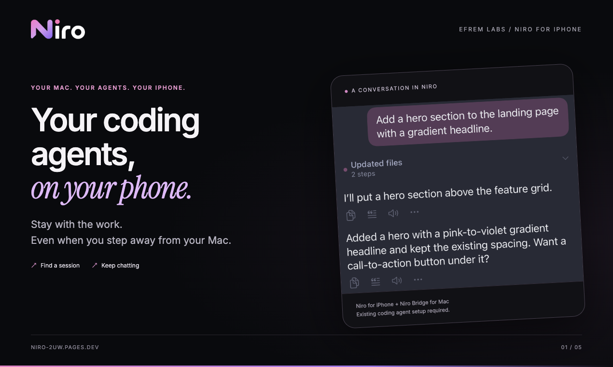
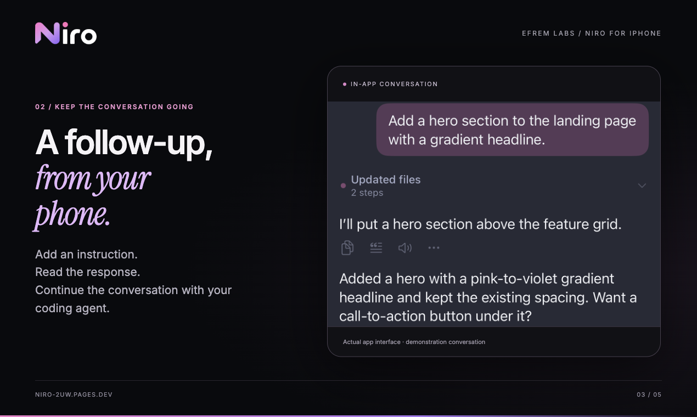
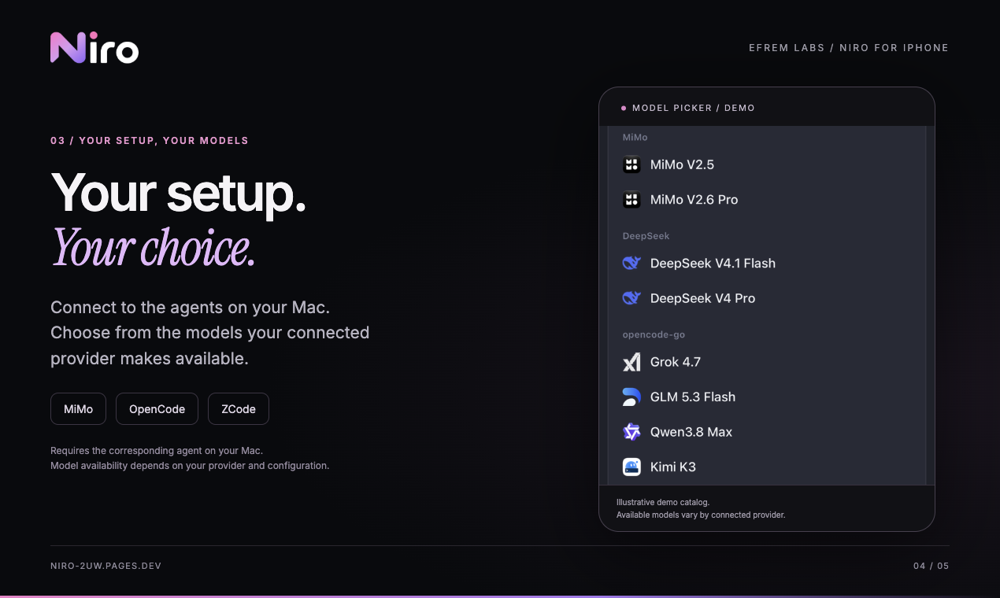

# Niro

**Your Coding Agents, on Your Phone.**

Niro is a free iPhone companion for the coding agents running on your Mac. Pick up a session, send the next instruction, check progress, and switch between supported providers without staying at your desk.

[**App Store**](https://apps.apple.com/app/niro/id6815434350) · [**Website**](https://niro-2uw.pages.dev) · [**Download Niro Bridge**](https://github.com/efrem-labs/niro-releases/releases/latest)



## Current release

**Release v0.2.1 (2026-10-25): Niro for iPhone 0.1.0 + Niro Bridge 0.1.3 (build 4).** Requires iOS 17+ and macOS 13+. The Bridge download is signed and Apple-notarized. Niro and Niro Bridge are free; provider/model access follows your own setup.

## Supported agents

- **MiMo Desktop**
- **OpenCode** — including headless `opencode serve` sessions
- **ZCode** — per-session model choice across ZCode's own model catalog
- **DeepSeek Harness (DSH)** — connected through a small, explicitly installed local companion

Niro Bridge normalizes the different local interfaces used by these agents into one phone-friendly connection. Provider credentials and model settings stay on the Mac — the phone never holds an agent's API keys.

## Features by provider

Features depend on the agent integration; availability is shown in Niro rather than assumed.

| Capability | MiMo Desktop | OpenCode | ZCode | DSH |
| --- | --- | --- | --- | --- |
| Existing sessions, chat, streaming replies, task progress | Yes | Yes | Yes | Yes |
| Stop a running task from Niro | On Mac | Yes | Yes | Yes |
| Answer permission requests from Niro | On Mac | Yes | Yes | Yes |
| Browse workspace folders and read files | Yes | Yes | Yes | Yes |
| Send file attachments | Yes | Yes | Unavailable | Yes |
| View change diffs | Yes | Yes | Unavailable | Unavailable |
| Delete sessions | Unavailable | Unavailable | Unavailable | Unavailable |

Workspace access is for browsing and reading, not a general file manager. Task-driven edits remain subject to the coding agent's permissions. Models come from each provider's own configuration; ZCode supports a per-session model choice. MiMo Desktop was previously verified; an uninstalled MiMo is shown as Not installed and is not a reason to reinstall it.

## How it works

1. Install **Niro** on your iPhone.
2. Install **Niro Bridge** on your Mac.
3. Open Niro Bridge. It lives quietly in the macOS menu bar.
4. Pair your iPhone and Mac on the same local network.
5. Continue your existing coding-agent sessions from the phone.

For DeepSeek Harness, Niro uses a small companion plugin in your Harness desktop profile. In the current release you install it yourself, by running the installer bundled inside Niro Bridge and then restarting DeepSeek Harness:

```bash
node "/Applications/Niro Bridge.app/Contents/Resources/harness-plugin/install.cjs"
```

The installer only adds or updates Niro's own entry in that profile, keeps a backup, and is safe to re-run. The companion opens no TCP port — it talks to Niro Bridge over an owner-only Unix socket — and Harness's own approvals and sandbox keep applying. Other Harness profiles are not touched.

## Approve from your phone

When an agent asks for permission — run this tool, write that file — you can allow or deny it from Niro for **DeepSeek Harness, ZCode, and OpenCode**, while Niro is connected and in the foreground. DSH approvals apply to one action, not a permanent exemption. If the phone has not been active for about 45 seconds, a new DSH request stays on the Mac; a forwarded request returns to the Mac if unanswered after 120 seconds. Other providers keep their own approval policies and timing. MiMo approvals stay on the Mac for now, so Niro shows them as "Approval required on Mac" instead of a button that couldn't act.

Background notifications are best-effort. There is no always-on remote push service; keep Niro connected and in the foreground for phone approvals.

## Keep the conversation going



Read the response, add a follow-up, and keep a task moving while you are away from the Mac.

## Your setup, your models



Niro uses the providers and models already available through your Mac setup. Availability varies by provider and configuration.

## Niro Bridge for macOS

Niro Bridge is the small macOS companion that connects Niro on iPhone to supported coding agents running on the Mac.

- Menu-bar app
- Supports MiMo Desktop, OpenCode, ZCode, and DeepSeek Harness
- Local pairing with explicit approval on the Mac
- No Niro account required

Download the latest build from [**Releases**](https://github.com/efrem-labs/niro-releases/releases/latest).

## Network & security

- **Local network first.** Niro Bridge runs only on your Mac and advertises itself over Bonjour (`_niro._tcp`). The phone always connects to the exact endpoint discovery hands it. There is no Niro server: session traffic never passes through anything operated by EFREM Labs.
- **Pairing is explicit.** A new iPhone is paired only after you tap Allow on the Mac. The Bridge token is delivered at that moment and stored in the iPhone Keychain; unauthenticated requests to the Bridge are rejected.
- **Away from home, bring your own network.** Niro has no cloud relay and no subscription. To use it away from your local network, your Mac must remain reachable through a network layer you set up and control — for example Tailscale. Niro talks to the same Bridge endpoint as it does at your desk; Niro itself does not require exposing the Bridge to the public internet. Remote reachability is part of your network setup — Niro does not configure or verify it.
- **Verify your download.** The current release ships with a `SHA256SUMS.txt` next to the DMG.

## Free

Niro is completely free. Optional in-app tips support EFREM Labs and do not unlock features.

## 中文说明

Niro 是 Mac 上 Coding Agent 的独立 iPhone 客户端，通过 Niro Bridge 接入 **MiMo Desktop、OpenCode、ZCode 和 DeepSeek Harness（DSH）**，与 Norna Loom 是不同产品。

- 当前正式版本：iPhone App **0.1.0**、Mac Bridge **0.1.3**、GitHub Release **v0.2.1**。需要 iOS 17+、macOS 13+；Mac 安装包已签名并通过 Apple 公证。
- 四种接入均可继续已有会话、发送指令、查看流式回复与任务进度，以及浏览工作区、读取文件。
- **OpenCode、ZCode 和 DSH** 支持在手机上停止任务、回答权限请求；**MiMo 的停止任务和审批仍在 Mac 上完成**。
- 文件附件：MiMo Desktop、OpenCode、DSH 支持，ZCode 暂不支持。变更差异：MiMo Desktop、OpenCode 支持，ZCode、DSH 暂不支持。均不支持删除会话；工作区查看不是完整文件管理器。
- DSH 需手动运行上方附带的伴随组件安装器，再重启 Harness；仅更新自己的 desktop profile 条目并备份。审批为单次有效；手机约 45 秒不活跃时新请求留给 Mac，转发后 120 秒未回答则回落至 Mac。其他 Provider 遵循各自策略。
- 在局域网配对并在 Mac 上批准；远程使用需通过你自己的网络（例如 Tailscale）保持 Mac 可达。Niro 不提供云中继，不保管代理 API Key。
- 手机审批需保持前台连接；后台通知为尽力送达，不保证锁屏持续推送。
- App 免费，打赏自愿、不解锁功能。此仓库仅提供发行包与文档，应用源码不公开。

## Support

For installation and connection help, start with [the download page and FAQ](https://niro-2uw.pages.dev/#faq-title) and the setup steps above. Keep the Mac and the chosen coding agents running, use the same LAN for pairing, and approve the phone on the Mac. DSH also needs its companion enabled; invalid OpenCode credentials must be corrected on the Mac. For remote access, check your own Tailscale/network reachability. Do not publish pairing tokens or provider credentials in support requests.

安装与连接问题请先查看[官网下载与常见问题](https://niro-2uw.pages.dev/#faq-title)及上方设置步骤。首次配对时保持同一局域网、Mac 与代理运行，并在 Mac 上允许连接；DSH 还需伴随组件。请勿公开配对令牌或代理凭据。

## About this repository

This public repository contains **Niro Bridge release binaries and product documentation**. The Niro iPhone app is distributed through the App Store. The application source code is not published here.

Made by **EFREM Labs**.
